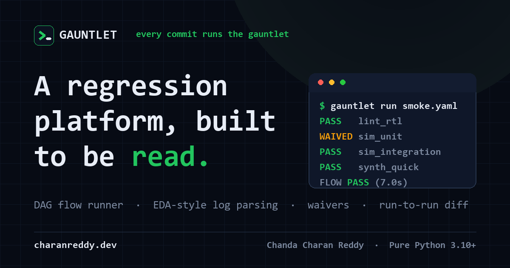

<div align="center">

# GAUNTLET

**every commit runs the gauntlet.**

A miniature IP-regression platform — the core loop of a chip-design regression
product, rebuilt small enough to read in an afternoon and honest enough to trust
in CI: **DAG-based flow execution → EDA-style log parsing → waivers → run-to-run
delta reporting.**

[](tests/)
[](pyproject.toml)
[-64748b?style=flat-square)](pyproject.toml)
[](#)
[](.github/workflows/gauntlet.yml)

[**Live site**](https://gauntlet.charanreddy.dev) · [The build story](web/project.html) · [About the developer](#about-the-developer)



</div>

---

Pure Python 3.10+. One dependency (PyYAML). No network, no services, no Docker —
real subprocesses, real signals, real exit codes, logs as files on disk.

## Why this exists

A green build isn't the question — **the delta is.** In chip design, a nightly
regression runs dozens of tools across a dependency graph, each spewing gigabyte
logs where a tool can exit `0` and still have failed. What a team actually needs
to know isn't "did tonight pass," it's *what broke that was working yesterday.*
GAUNTLET rebuilds that loop end to end, refusing to fake the hard parts.

## Architecture

```
 flows/smoke.yaml          rulepacks/*.yaml         waivers/waivers.yaml
       │                          │                          │
       ▼                          ▼                          ▼
 ┌───────────┐            ┌──────────────┐          ┌───────────────┐
 │  flow.py  │            │   rules.py   │          │   waivers.py  │
 │ validate, │            │ compile regex│          │ rule_id+substr│
 │ cycle-chk │            │  rulepacks   │          │    matching   │
 └─────┬─────┘            └──────┬───────┘          └───────┬───────┘
       │ FlowSpec                └──────────┬───────────────┘
       ▼                                    ▼
 ┌──────────────────┐   StepResult   ┌──────────────┐
 │   scheduler.py   │───────────────▶│  parser.py   │  log → Violations,
 │ ThreadPool ready-│◀───────────────│ LogEvaluator │  waive, re-status
 │ set DAG executor │  final status  └──────────────┘
 └────────┬─────────┘
          │ runs Step.run() per step        ┌─────────────────────────┐
          ▼                                 │  runs/<run_id>/         │
 ┌──────────────────┐                       │    <step_id>/output.log │
 │     steps.py     │── subprocess, own ───▶│    manifest.json        │
 │ Step ABC         │   process group,      └─────────────────────────┘
 │ └── ShellStep    │   signal→grace→kill
 └──────────────────┘
          │ RunRecord
          ▼
 ┌──────────────────┐        ┌──────────────┐        ┌──────────────┐
 │     store.py     │───────▶│   diff.py    │───────▶│  report.py   │
 │ SQLite: runs,    │        │ NEW FAILURES │        │ terminal     │
 │ steps, violations│        │ FIXED / ...  │        │ rendering    │
 └──────────────────┘        └──────────────┘        └──────────────┘
```

See [`PROJECT_DEEP_DIVE.md`](PROJECT_DEEP_DIVE.md) for the full data-flow and the
decisions behind each box.

## Quickstart

```bash
pip install -e ".[dev]"
pytest                       # 43 tests, ~3s, fully offline
gauntlet run flows/smoke.yaml
```

> On Windows, use `py -m pytest` and make sure `python` is on your `PATH` (the
> mock tools in `flows/smoke.yaml` invoke `python`). The test suite itself is
> fully cross-platform.

## The demo — watch a regression surface

```bash
# 1. clean run, deterministic (sim_unit hits a known, waived TB failure)
GAUNTLET_SEED=7 gauntlet run flows/smoke.yaml --workers 4

# 2. introduce a flake, run again (sim_unit now hits an UNWAIVED overflow)
GAUNTLET_SEED=7 GAUNTLET_FLAKE=0.3 gauntlet run flows/smoke.yaml --workers 4 --keep-going

# 3. the money shot
gauntlet history -n 2
gauntlet diff <run_1> <run_2>       # exits 1 → CI-usable
```

What to look at:

1. **Run 1:** both sims run in parallel after lint (DAG scheduling), and
   `sim_unit` shows `WAIVED` — its known fifo-overflow error is waived in
   `waivers/waivers.yaml` with an owner and a JIRA-style reason.
2. **Run 2:** the flake injects `fifo overflow in u_fifo_tx`. Same rule id
   (`SIM-ERR-007`) but the waiver's `match: u_fifo_rx` substring doesn't hit,
   so the step FAILs — waivers are precise, not blanket.
3. **The diff:** `NEW FAILURES: sim_unit`. That delta — not any single run's
   pass/fail — is what a regression platform exists to produce.

Mock-tool knobs: `GAUNTLET_SEED=<int>` makes tool output byte-identical between
runs; `GAUNTLET_FLAKE=<0..1>` is the probability each tool emits an extra ERROR
and exits 1.

## Features

| | |
|---|---|
| **DAG scheduler** | Ready-set executor over a `ThreadPoolExecutor`. A step runs only when every dependency is `PASS`/`WAIVED`; failures cascade `SKIPPED` transitively; `--keep-going` lets independent branches finish. |
| **Log is the truth** | A tool can exit `0` and still `FAIL` if its log holds an unwaived `ERROR`. Logs are streamed line-by-line against compiled regex rulepacks — never read whole. |
| **Waivers as debt** | `rule_id` + substring match, each with an owner and reason. A waived failure is `WAIVED` (visible), never a silent pass. |
| **Run-to-run diff** | Buckets `NEW FAILURES` / `FIXED` / `STILL FAILING` and exits non-zero on regressions, so CI can gate on the delta. |
| **SQLite memory** | `history`, `report`, and `diff` all work from the DB alone, long after raw logs are cleaned up. |
| **Timeouts kill the tree** | Steps run in their own process group; on timeout the whole group is signalled, graced, then hard-killed — cross-platform (POSIX + Windows). |
| **Shareable HTML report** | `report <run> --html out.html` writes one self-contained page — zero new dependencies. |
| **Honest retries** | A step that only passes on retry is marked *flaky*: it satisfies dependents, but every report says so. |

## CLI

| command | purpose | exit codes |
|---|---|---|
| `gauntlet run <flow.yaml> [--workers N] [--keep-going]` | execute a flow | 0 all PASS/WAIVED · 1 any FAIL/TIMEOUT · 2 config error |
| `gauntlet history [-n 10]` | recent runs from SQLite | 0 |
| `gauntlet report <run_id> [--html out.html]` | re-render a stored run | 0 · 2 unknown run |
| `gauntlet diff <run_a> <run_b>` | run-to-run regression delta | 0 · 1 new failures · 2 unknown run |

## Design notes

- **`Step` is an ABC** because the scheduler's contract is just
  `run() -> StepResult`. `ShellStep` is one implementation; a `PythonStep` or
  `RemoteStep` later touches zero scheduler code.
- **Threads, not asyncio/processes.** Workers spend their lives blocked in
  `subprocess.wait()`, where the GIL is released — a `ThreadPoolExecutor` gives
  real parallelism with none of the ceremony.
- **Timeouts kill the whole tree.** Steps launch in their own process group; on
  timeout we signal the group (SIGTERM on POSIX, CTRL_BREAK then `taskkill /T`
  on Windows), grace it, then hard-kill. A shell wrapper dying while its child
  simulator lives on is the classic infra bug this avoids.
- **A tool can exit 0 and still FAIL** if its log contains an unwaived ERROR —
  real EDA tools under-report via exit codes, so the log is the source of truth.
- **WAIVED is a distinct status,** not silently PASS: waived failures stay
  visible in every report, with owner and reason, because a waiver is a debt,
  not a fix.
- **Logs are streamed line by line,** never read whole — production EDA logs run
  to gigabytes.
- **`SKIPPED` is not a failure in diffs.** A skipped step gives no new evidence
  against itself; the diff blames the upstream step that actually failed.

## Website

A polished, deployable marketing/showcase site lives in [`web/`](web/) — a
static, dependency-free build (hand-written HTML/CSS/JS, dark-first terminal
aesthetic, light-mode toggle, fully responsive, accessible). It ships to Vercel
as-is; see [`DEPLOYMENT.md`](DEPLOYMENT.md).

- `web/index.html` — overview, how-it-works, the money-shot diff, features
- `web/project.html` — the build story, timeline, technical decisions, stack
- `web/about.html` — about the developer + contact

## Layout

```
gauntlet/           the package: cli, models, flow, steps, scheduler,
                    parsing/{rules,parser,waivers}, store, diff, report, html_report
flows/              flow definitions (YAML DAGs)
rulepacks/          per-tool regex rulepacks
waivers/            documented exceptions with owners and reasons
tools/mock/         fake lint/sim/synth generating realistic logs
tests/              pytest suite (offline, deterministic, cross-platform, <10s)
web/                static showcase site (deploy target for Vercel)
runs/               created at runtime: per-step logs, manifest.json, gauntlet.db
```

## Docs

- [`PROJECT_DEEP_DIVE.md`](PROJECT_DEEP_DIVE.md) — architecture, data flow, folder structure, the hard parts
- [`INTERVIEW_PREP.md`](INTERVIEW_PREP.md) — walkthrough, elevator pitch, STAR stories, likely Q&A
- [`DEPLOYMENT.md`](DEPLOYMENT.md) — ship the site to Vercel + a manual checklist

## About the developer

**Chanda Charan Reddy** — AI & Automation Engineer, Bangalore. I ship production
LLM systems — from a Springer-published model that reads chest X-rays well enough
for a radiologist to take seriously, to document pipelines that run themselves.
Before all that, I wrote real-time control code for jet engines at DRDO. GAUNTLET
is that instinct pointed at regression infrastructure: not "did the build pass,"
but "what quietly broke, and who owns it."

This is one project. There are 18 more (and a few jet engines) over at my portfolio.

[Portfolio](https://www.charanreddy.dev) · [GitHub](https://github.com/charanreddy-27) · [LinkedIn](https://www.linkedin.com/in/chandacharanreddy/) · [Book a call](https://cal.com/charanreddy-27/30min)

<sub>Crafted with intent. Available for new projects.</sub>
