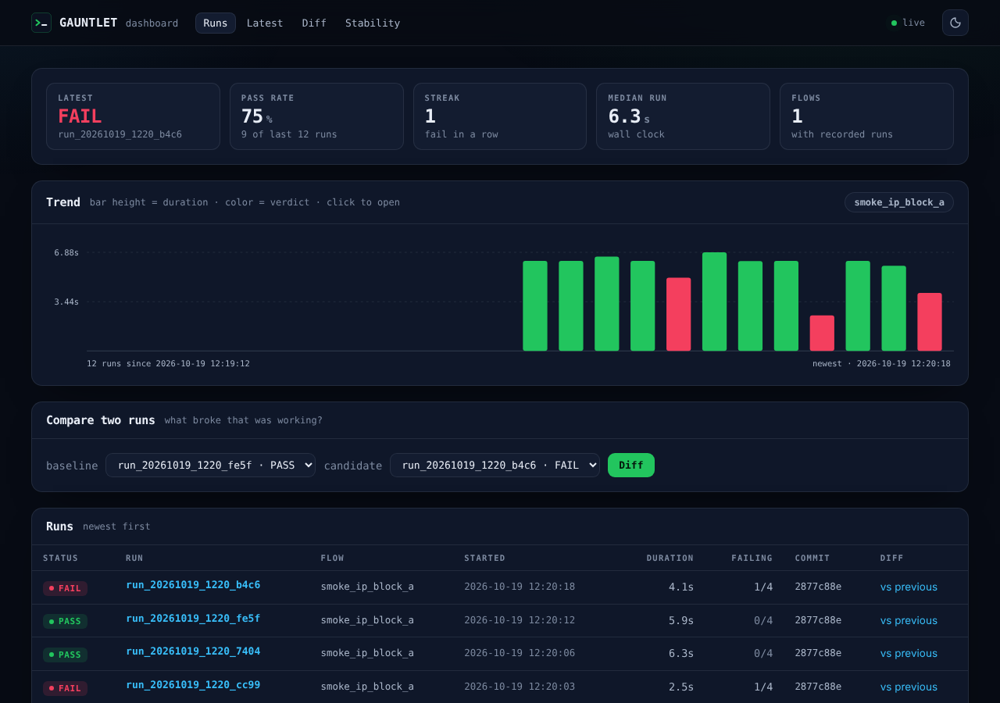
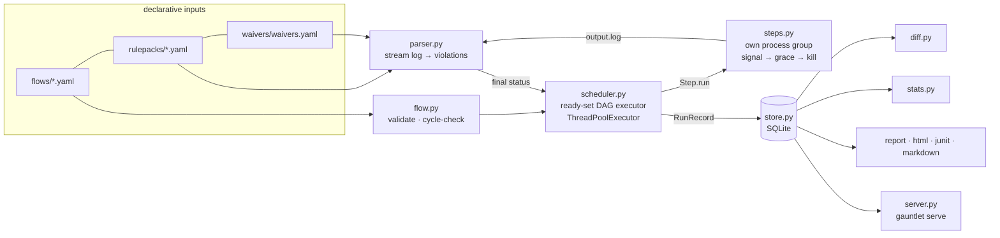
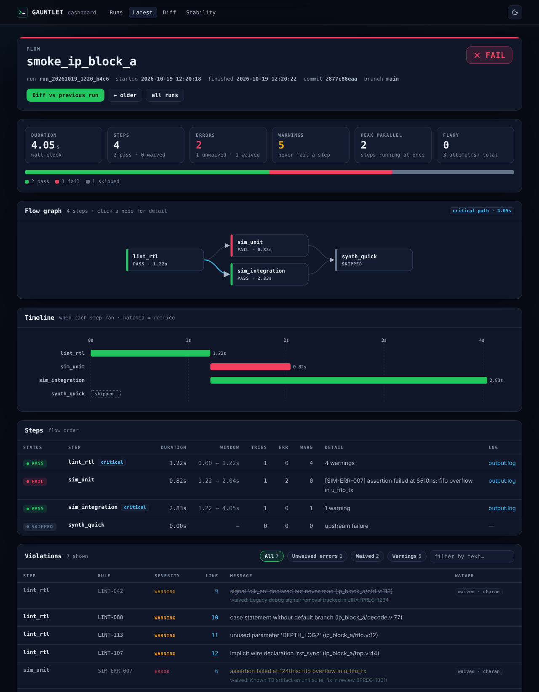
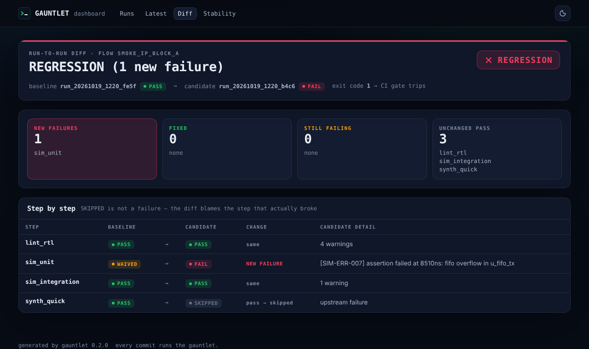
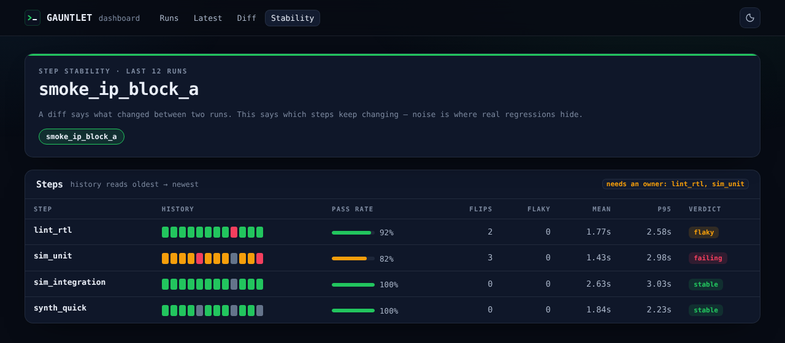
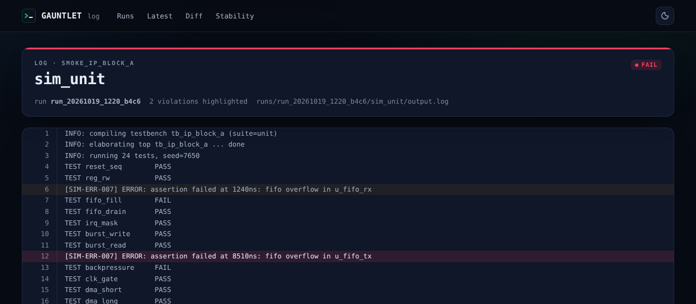

<div align="center">

# GAUNTLET

**every commit runs the gauntlet.**

A miniature IP-regression platform — the core loop of a chip-design regression
product, rebuilt small enough to read in an afternoon and honest enough to trust
in CI: **DAG-based flow execution → EDA-style log parsing → waivers → run-to-run
delta reporting** — now with a local dashboard, CI-native outputs and stability
tracking.

[](https://github.com/charanreddy-27/GAUNTLET/actions/workflows/gauntlet.yml)
[](tests/)
[](pyproject.toml)
[-64748b?style=flat-square)](pyproject.toml)
[](#)

[**Live site**](https://gauntlet-charanreddy-27s-projects.vercel.app) · [Try it in the browser](https://gauntlet-charanreddy-27s-projects.vercel.app/#playground) · [A real report](https://gauntlet-charanreddy-27s-projects.vercel.app/demo/report) · [The build story](web/project.html)



</div>

---

Pure Python 3.10+. One dependency (PyYAML). No network, no services, no Docker —
real subprocesses, real signals, real exit codes, logs as files on disk.

## Why this exists

A green build isn't the question — **the delta is.** In chip design, a nightly
regression runs dozens of tools across a dependency graph, each spewing gigabyte
logs where a tool can exit `0` and still have failed. What a team actually needs
to know isn't "did tonight pass," it's *what broke that was working yesterday* —
and *which steps keep breaking*. GAUNTLET rebuilds that loop end to end, refusing
to fake the hard parts.

## What's new in v0.2

| | |
|---|---|
| **`gauntlet serve`** | A local, read-only dashboard over the run database: history with a trend chart, a full report per run, any-two-runs diff, per-step stability, and a log viewer that highlights the exact lines a rulepack matched. Stdlib only (`http.server` + `sqlite3`); reloads itself when a new run lands. |
| **A real report** | `--html` reports now draw the flow DAG with the duration-weighted **critical path** lit, a **timeline** of when each step actually ran, filterable violations, and the **waiver debt** by owner. Self-contained, offline, prints cleanly. |
| **CI-native outputs** | `--junit` for every CI test tab; `--markdown` for `$GITHUB_STEP_SUMMARY` (the DAG renders as Mermaid). WAIVED never flattens into a plain pass. |
| **`gauntlet stats`** | Per-step pass rate, flips, flaky retries and p95 duration across the last N runs — and the steps that need an owner. |
| **`gauntlet graph`** | A flow's layers and longest chain, as text, Mermaid or DOT. |
| **Run refs** | `latest` and `latest~N` work anywhere a run id does: `gauntlet diff latest~1 latest`. |
| **Run context** | Every run records each step's window, attempts, the waiver owner, and the git commit and branch it tested. Old databases migrate in place. |

## Architecture



See [`PROJECT_DEEP_DIVE.md`](PROJECT_DEEP_DIVE.md) for the full data flow and the
decisions behind each box.

## Quickstart

```bash
pip install -e ".[dev]"
pytest                       # 67 tests, ~6s, fully offline
gauntlet run flows/smoke.yaml
gauntlet serve --open        # the dashboard, on http://127.0.0.1:8765
```

> On Windows, use `py -m pytest` and make sure `python` is on your `PATH` (the
> mock tools in `flows/smoke.yaml` invoke `python`). The test suite itself is
> fully cross-platform and CI runs it on Linux, macOS and Windows.

## The demo — watch a regression surface

```bash
# 1. clean run, deterministic (sim_unit hits a known, waived TB failure)
GAUNTLET_SEED=7 gauntlet run flows/smoke.yaml --workers 4

# 2. introduce a flake, run again (sim_unit now hits an UNWAIVED overflow)
GAUNTLET_SEED=7 GAUNTLET_FLAKE=0.3 gauntlet run flows/smoke.yaml --workers 4 --keep-going

# 3. the money shot
gauntlet diff latest~1 latest      # exits 1 → CI-usable
gauntlet serve --open              # …or click "Diff vs previous run"
```

What to look at:

1. **Run 1:** both sims run in parallel after lint (DAG scheduling — the report's
   timeline shows the overlap), and `sim_unit` shows `WAIVED` — its known
   fifo-overflow error is waived in `waivers/waivers.yaml` with an owner and a
   JIRA-style reason.
2. **Run 2:** the flake injects `fifo overflow in u_fifo_tx`. Same rule id
   (`SIM-ERR-007`) but the waiver's `match: u_fifo_rx` substring doesn't hit,
   so the step FAILs — waivers are precise, not blanket.
3. **The diff:** `NEW FAILURES: sim_unit`. That delta — not any single run's
   pass/fail — is what a regression platform exists to produce.

Mock-tool knobs: `GAUNTLET_SEED=<int>` makes tool output byte-identical between
runs; `GAUNTLET_FLAKE=<0..1>` is the probability each tool emits an extra ERROR
and exits 1. Or skip the install entirely and
[break the build in your browser](https://gauntlet-charanreddy-27s-projects.vercel.app/#playground).

## Screenshots

| Run report | Diff |
|---|---|
|  |  |
| **Stability** | **Log viewer** |
|  |  |

Light mode is automatic (`prefers-color-scheme`) with a toggle —
[screenshot](docs/screenshots/report_light.png).

## Use it in CI

The platform gates its own CI on the delta — see
[`.github/workflows/gauntlet.yml`](.github/workflows/gauntlet.yml), which also
proves the gate trips on an injected regression. The pattern:

```yaml
- run: gauntlet run flows/nightly.yaml --keep-going --junit junit.xml --html report.html || true
- run: gauntlet report latest --markdown - >> "$GITHUB_STEP_SUMMARY"
- run: gauntlet diff latest~1 latest        # exit 1 on NEW failures → the job fails
```

Branch and commit are recorded with every run (from git, or from
`GITHUB_HEAD_REF` / `CI_COMMIT_REF_NAME` / `BRANCH_NAME` on detached CI
checkouts). Set `GAUNTLET_GIT_COMMIT` / `GAUNTLET_GIT_BRANCH` to override, and
`GAUNTLET_RUNS_DIR` to keep the database somewhere other than `./runs`.

## Features

| | |
|---|---|
| **DAG scheduler** | Ready-set executor over a `ThreadPoolExecutor`. A step runs only when every dependency is `PASS`/`WAIVED`; failures cascade `SKIPPED` transitively; `--keep-going` lets independent branches finish. |
| **Log is the truth** | A tool can exit `0` and still `FAIL` if its log holds an unwaived `ERROR`. Logs are streamed line-by-line against compiled regex rulepacks — never read whole. |
| **Waivers as debt** | `rule_id` + substring match, each with an owner and reason. A waived failure is `WAIVED` (visible), never a silent pass — and reports list the debt by owner. |
| **Run-to-run diff** | Buckets `NEW FAILURES` / `FIXED` / `STILL FAILING` and exits non-zero on regressions, so CI can gate on the delta. |
| **SQLite memory** | `history`, `report`, `diff`, `stats` and `serve` all work from the DB alone, long after raw logs are cleaned up. Older databases migrate in place. |
| **Timeouts kill the tree** | Steps run in their own process group; on timeout the whole group is signalled, graced, then hard-killed — cross-platform (POSIX + Windows). |
| **Honest retries** | A step that only passes on retry is marked *flaky*: it satisfies dependents, but every report says so, and `stats` counts it across runs. |
| **Reports for people and machines** | Terminal (colored on a TTY, `NO_COLOR` respected), single-file HTML, JUnit XML, GitHub Markdown, JSON (`diff --json`, `/api/*`). |

## CLI

| command | purpose | exit codes |
|---|---|---|
| `gauntlet run <flow.yaml> [--workers N] [--keep-going] [--html P] [--junit P] [--markdown P]` | execute a flow | 0 all PASS/WAIVED · 1 any FAIL/TIMEOUT · 2 config error |
| `gauntlet history [-n 10] [--flow NAME]` | recent runs from SQLite | 0 |
| `gauntlet report <run> [--html P] [--junit P] [--markdown P]` | re-render a stored run | 0 · 2 unknown run |
| `gauntlet diff <run_a> <run_b> [--html P] [--markdown P] [--json]` | run-to-run regression delta | 0 · 1 new failures · 2 unknown run |
| `gauntlet stats [-n 20] [--flow NAME]` | per-step stability across recent runs | 0 |
| `gauntlet graph <flow.yaml> [--format ascii\|mermaid\|dot]` | show a flow's dependency graph | 0 · 2 config error |
| `gauntlet serve [--host 127.0.0.1] [--port 8765] [--open]` | local read-only dashboard | 0 · 2 port unavailable |

`<run>` is a run id, `latest`, or `latest~N`. `--markdown -` writes to stdout.

## Design notes

- **`Step` is an ABC** because the scheduler's contract is just
  `run() -> StepResult`. `ShellStep` is one implementation; a `PythonStep` or
  `RemoteStep` later touches zero scheduler code.
- **Threads, not asyncio/processes.** Workers spend their lives blocked in
  `subprocess.wait()`, where the GIL is released — a `ThreadPoolExecutor` gives
  real parallelism with none of the ceremony.
- **Timeouts kill the whole tree.** Steps launch in their own process group; on
  timeout we signal the group (SIGTERM on POSIX, CTRL_BREAK then `taskkill /T`
  on Windows), grace it, then hard-kill.
- **A tool can exit 0 and still FAIL** if its log contains an unwaived ERROR —
  real EDA tools under-report via exit codes, so the log is the source of truth.
- **WAIVED is a distinct status,** not silently PASS — in the terminal, the HTML,
  JUnit (a `gauntlet.status` property plus the waived errors in `system-out`)
  and Markdown alike. A waiver is a debt, not a fix.
- **`SKIPPED` is not a failure in diffs.** A skipped step gives no new evidence
  against itself; the diff blames the upstream step that actually failed.
- **Charts are laid out in Python.** Reports emit plain SVG: they render offline,
  print, and need no JavaScript to be read. JS only adds filters and the theme
  toggle.
- **The dashboard can't become a file server.** Logs are looked up by run and
  step, resolved, and refused unless they sit inside the runs directory —
  whatever the database says.

## Website

A deployable showcase site lives in [`web/`](web/) — static, dependency-free
(hand-written HTML/CSS/JS), dark-first with a light toggle, responsive and
accessible. It includes an **interactive playground** that replays the
scheduler's rules in the browser, and **real sample reports** generated by the
tool itself (`python scripts/build_site_demo.py` regenerates them). It ships to
Vercel as-is; see [`DEPLOYMENT.md`](DEPLOYMENT.md).

## Layout

```
gauntlet/           the package: cli, models, flow, steps, scheduler, store, diff,
                    graph, stats, report, term, junit, markdown, html_report,
                    server, parsing/{rules,parser,waivers}, ui/{theme,charts,pages}
flows/              flow definitions (YAML DAGs)
rulepacks/          per-tool regex rulepacks
waivers/            documented exceptions with owners and reasons
tools/mock/         fake lint/sim/synth generating realistic logs
tests/              pytest suite (offline, deterministic, cross-platform)
scripts/            build_site_demo.py — regenerates web/demo from real runs
web/                static showcase site (deploy target for Vercel)
docs/screenshots/   README images, captured from `gauntlet serve`
runs/               created at runtime: per-step logs, manifest.json, gauntlet.db
```

## Docs

- [`PROJECT_DEEP_DIVE.md`](PROJECT_DEEP_DIVE.md) — architecture, data flow, folder structure, the hard parts
- [`INTERVIEW_PREP.md`](INTERVIEW_PREP.md) — walkthrough, elevator pitch, STAR stories, likely Q&A
- [`DEPLOYMENT.md`](DEPLOYMENT.md) — ship the site to Vercel + a manual checklist
- [`CHANGELOG.md`](CHANGELOG.md) — what changed, release by release

## About the developer

**Chanda Charan Reddy** — AI & Automation Engineer, Bangalore. I ship production
LLM systems — from a Springer-published model that reads chest X-rays well enough
for a radiologist to take seriously, to document pipelines that run themselves.
Before all that, I wrote real-time control code for jet engines at DRDO. GAUNTLET
is that instinct pointed at regression infrastructure: not "did the build pass,"
but "what quietly broke, and who owns it."

This is one project. There are 18 more (and a few jet engines) over at my portfolio.

[Portfolio](https://www.charanreddy.dev) · [GitHub](https://github.com/charanreddy-27) · [LinkedIn](https://www.linkedin.com/in/chandacharanreddy/) · [Book a call](https://cal.com/charanreddy-27/30min)

<sub>Crafted with intent. Available for new projects.</sub>
